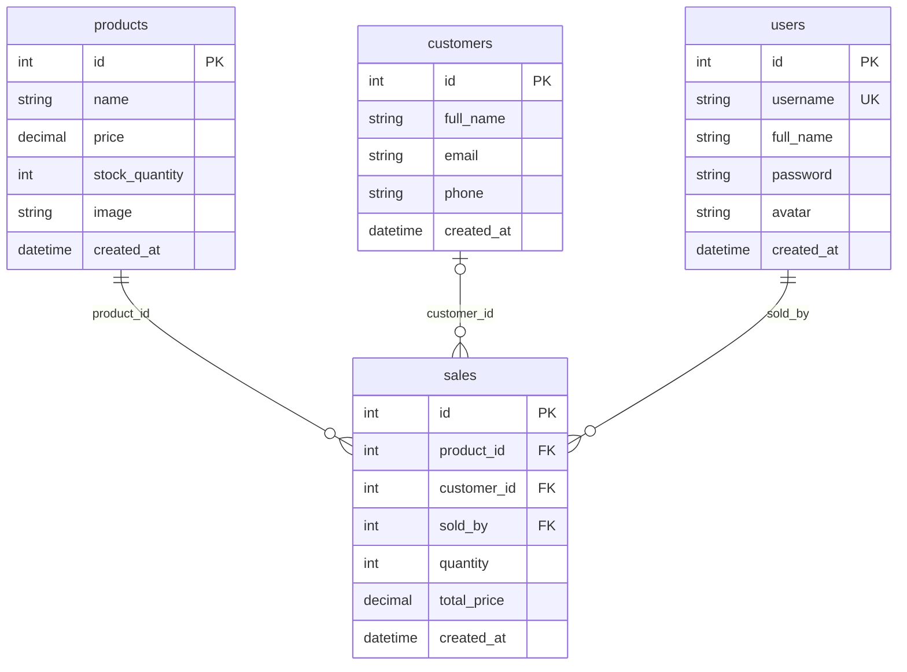

# Counter — IT0049 Point-of-Sale System

Live application: https://it0049-counter-pos.42web.io/

CodeIgniter 4.7.6 / PHP / MySQL or MariaDB. Created for the IT0049 Midterm Project by Rodriguez, Robert Enzo (Encoder) & Dela Cruz, John Paul (Designer). BSIT - AGD, Section AX 31. Professor: Merlin Marfa.

## Run on this computer

Open `START-LOCAL.cmd` in this folder, then visit http://localhost:8085 . Keep the console open while using the application. If the preview is already running, use that address directly instead of opening a second server.

- Username: `admin`
- Local login details are in the private submission guide supplied with the local project.
- Local database: `writable/pos.sqlite` (SQLite; generated from the same migrations).
- This is a local preview address. It is not the hosted submission link.

The full folder includes installed Composer dependencies. The source ZIP intentionally excludes vendor, runtime files and `.env`; a fresh clone needs `composer install` and environment setup. The launcher expects PHP at `C:\xampp\php\php.exe`, falling back to `php` on PATH. It enables GD and SQLite for the process, creates upload temporary storage, runs migrations/seeding and starts the development server. Set POS_ADMIN_PASSWORD in your private .env before first seeding. Port 8085 must be free. An existing demo admin password is never reset by the seeder.

## Features

- Staff login, session regeneration, throttled sign-in, logout, and authentication on all management and media routes.
- Products: list/create/edit/delete, price and stock validation, optional product image.
- Customers: full CRUD with validated email and phone.
- Staff: full CRUD, unique usernames, password hashing, optional avatar. Blank edit password keeps the current hash; staff cannot delete their own signed-in account.
- Safe images: JPEG/PNG/WebP only, maximum 2 MB, dimensions limited to 6000 px / 16 megapixels; decoded, resized to at most 800 px and re-encoded as JPEG with random filenames outside the public directory. Authenticated image endpoint serves JPEG only.
- Record sale: one product per sale as specified, optional customer, positive integer quantity, trusted staff ID from session, current server-side price.
- Inventory and sales commit together. MySQL uses an InnoDB row lock and conditional stock update to prevent overselling. Currency totals use integer centavos.
- Sales history lists product, customer/walk-in, staff, quantity, total and Asia/Manila date.
- CSRF tokens on POST forms, explicit routes, escaped output, prepared/bound database values.
- Responsive dashboard and stock watch.

All staff have the same management permissions, matching the assignment. Products/staff referenced by sales cannot be deleted because history must remain valid. Unused products/staff can be deleted. Deleting customers sets their sales customer to NULL (walk-in); sale totals remain unchanged. Names in history reflect current directory names. Sales are intentionally not editable/deletable through the application.

## MySQL / MariaDB setup

Requires PHP 8.2+ with intl, mbstring, mysqli/mysqlnd, fileinfo and GD; Composer; MySQL or MariaDB with InnoDB; Apache/nginx with URL rewriting. Enable SQLite3 only if using the local preview or PHPUnit suite. Allow uploads of at least 2 MB (`upload_max_filesize=2M`, `post_max_size=8M`) and set a writable PHP upload temporary directory.

1. Create an empty UTF-8 database, for example `it0049_pos`.
2. Install dependencies: `composer install` (production: `composer install --no-dev --optimize-autoloader`).
3. Copy `.env.example` to `.env`. Set actual database credentials, port and the site's base URL including trailing slash. Use `CI_ENVIRONMENT = development` and `cookie.secure = false` only for local HTTP. Production should use HTTPS, production mode and secure cookies.
4. Set `POS_ADMIN_PASSWORD` to your private initial admin password (10–72 characters).
5. Run `php spark migrate --all` then `php spark db:seed PosSeeder`.
6. Point the web server document root at **public/**. Give the web-server account write access to `writable/`; keep `.env`, app and vendor outside the public root.
7. Sign in as `admin` using the chosen password. Change the example value before publishing. Do not commit `.env`.

Alternative: import `database/it0049_pos.sql` into an empty MySQL/MariaDB database instead of running migrations/seeding. It includes migration tracking and sample products/customer, but no staff credentials. After importing, set POS_ADMIN_PASSWORD in your private environment and run `php spark db:seed PosSeeder` to create the initial admin. Do not reinitialize the schema.

## Submission files

The assignment asks for **two links**, not just an archive:

1. A GitHub repository link with raw project files plus database export or migrations/seeders.
2. A public hosted working application link matching that code.

The source includes all three database options:

- `database/it0049_pos.sql` — MySQL/MariaDB export with clean sample data.
- `app/Database/Migrations/2026-11-27-000001_CreatePos.php` — relational schema and foreign keys.
- `app/Database/Seeds/PosSeeder.php` — sample products/customer and hashed admin account.

Upload the extracted source files to the repository root, including dotfiles such as `.gitignore` and `.env.example`. Do not upload the ZIP as the only repository content. `composer.json` and `composer.lock` restore vendor dependencies. Runtime SQLite databases, uploads, sessions, logs and real secrets are excluded by `.gitignore`.

Git commands after creating your empty repository (replace OWNER/REPOSITORY):

```sh
git init
git add .
git commit -m "Complete IT0049 CodeIgniter POS"
git branch -M main
git remote add origin https://github.com/OWNER/REPOSITORY.git
git push -u origin main
```

## Hosting

Use a PHP-capable host with MySQL/MariaDB and persistent writable storage. Follow the MySQL setup above using the host's database credentials. GitHub Pages cannot execute this PHP application. The host must serve `public/`, preserve uploaded images in `writable/uploads/pos`, and support rewritten routes. Do not expose the entire repository as the web root. After deployment, verify login, product upload, a successful sale, oversell rejection and sales history from the public URL. Send the instructor demo login details privately if required.

Repository: https://github.com/nezhalee06/IT0049-Point-of-Sale

Hosted application: https://it0049-counter-pos.42web.io/

Hosting uses the included root `.htaccess` to route requests into `public/` while denying direct access to application code, dependencies and private environment files on the fixed shared-host document root. Environment credentials and the initial hosted staff account are configured privately.

## Architecture and schema

Routes -> authentication/CSRF filters -> controllers -> models or SaleRecorder -> database -> escaped views.

- Controllers: Auth, Dashboard, Catalog, Sales.
- Models: ProductModel, CustomerModel, StaffModel.
- SaleRecorder owns sale validation, inventory locking, exact totals and transaction rollback.
- ImageUpload owns image validation, conversion, storage and cleanup.
- Views and local CSS: `app/Views/pos/`, `public/assets/pos.css`.



## Validation

Run unit/integration sales tests using an isolated in-memory SQLite database:

```sh
php -d extension=sqlite3 vendor/phpunit/phpunit/phpunit -c phpunit.pos.xml
```

If SQLite is already enabled, omit the `-d extension=sqlite3` flag. Five tests / 19 assertions cover totals, stock deduction, overselling, walk-in/exact stock, invalid relationships and rollback after a failed insert.

`tests/http_smoke.py` provides 33 HTTP checks for authentication, CSRF, CRUD, image conversion/rejection and sales. Run it ONLY against a disposable newly seeded database and a local server (`python tests/http_smoke.py http://localhost:8085`). Set the POS_TEST_PASSWORD environment variable to the disposable admin password before running the HTTP checks. It creates test records and transactions. Never run this against the submission/demo database or real store data.

`docs/VALIDATION.txt` records the completed verification and its limits.

## References

- CodeIgniter transactions: https://codeigniter4.github.io/userguide/database/transactions.html
- Deployment and public web root: https://codeigniter4.github.io/userguide/installation/running.html
- Assignment: IT0049 Midterm Project — Complete Point-of-Sale System (CodeIgniter), provided by the user.
